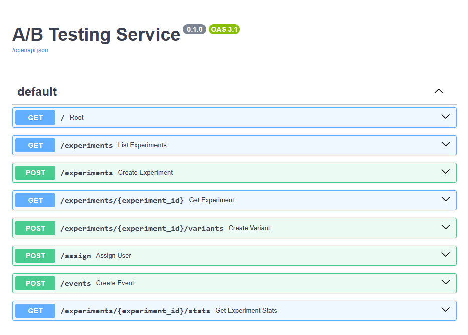
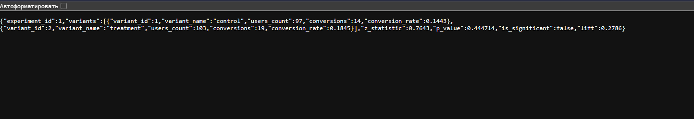

# 🧪 A/B Testing Service

REST API для управления A/B-экспериментами: создание экспериментов, распределение пользователей по группам, сбор событий и расчёт статистики (Z-тест, p-value, доверительная значимость).

##  Что делает проект

1. **Управление экспериментами** — создание, запуск, остановка A/B-тестов.
2. **Распределение трафика** — детерминированное назначение пользователей в группы через MD5-хэширование.
3. **Сбор событий** — приём событий (клик, покупка, регистрация) от пользователей.
4. **Статистика** — расчёт конверсий по группам, Z-тест, p-value, lift.

## 📸 Скриншоты

**Swagger UI — все эндпоинты:**


**Результат A/B-теста — статистика с Z-тестом:**


##  Архитектура БД

```text
experiments
  ├── id (PK)
  ├── name
  ├── description
  ├── status (draft / running / stopped)
  └── created_at
       │
       │ 1:N
       ▼
variants                                    assignments
  ├── id (PK)                                 ├── id (PK)
  ├── experiment_id (FK → experiments.id)     ├── experiment_id (FK)
  ├── name (control / treatment)              ├── variant_id (FK)
  ├── weight (0.0 – 1.0)                      ├── user_id
  └── is_control (bool)                       └── assigned_at
                                                   │
                                                   │ UNIQUE (experiment_id, user_id)
                                                   │
                                              events
                                                ├── id (PK)
                                                ├── experiment_id (FK)
                                                ├── variant_id (FK)
                                                ├── user_id
                                                ├── event_type (click / purchase / signup)
                                                └── created_at
```

**Ключевые решения:**
- **`UNIQUE(experiment_id, user_id)`** в `assignments` — один пользователь не может попасть в эксперимент дважды.
- **`variant_id` в `events`** — сервер подставляет его **из assignment**, не из запроса. Защита от подделки данных клиентом.

##  Эндпоинты

| Метод | URL | Описание |
|---|---|---|
| `GET` | `/` | Проверка работоспособности сервиса |
| `POST` | `/experiments` | Создать эксперимент |
| `GET` | `/experiments` | Список всех экспериментов |
| `GET` | `/experiments/{id}` | Детали эксперимента |
| `POST` | `/experiments/{id}/variants` | Создать вариант (control / treatment) |
| `POST` | `/assign` | Назначить пользователя в группу |
| `POST` | `/events` | Записать событие (конверсию) |
| `GET` | `/experiments/{id}/stats` | Статистика: конверсии, Z-тест, p-value |

##  Логика распределения трафика

Пользователи распределяются **детерминированно** — через MD5-хэш `user_id`:

```python
hash_value = int.from_bytes(md5(user_id.encode()).digest()[:8], "big") / 2**64
```

Полученное число от 0 до 1 сравнивается с накопленными весами вариантов. Один и тот же `user_id` **всегда** попадает в одну группу — без записи в БД для определения группы.

**Преимущества:**
- Нет лишних запросов к БД при каждом заходе.
- Стабильность: пользователь видит одну версию всегда.
- Баланс 50/50 при весах `0.5 / 0.5`.

##  Статистика

Эндпоинт `/experiments/{id}/stats` считает:
- **Конверсию** по каждой группе — доля уникальных пользователей с событиями.
- **Z-статистику** для двух долей.
- **p-value** — вероятность случайности результата.
- **Significance** — `p-value < 0.05`.
- **Lift** — относительный прирост конверсии treatment относительно control.

**Использован тот же Z-тест для долей, что в продуктовой аналитике.** Пример ответа:

```json
{
  "experiment_id": 1,
  "variants": [
    {"variant_name": "control", "users_count": 97, "conversions": 14, "conversion_rate": 0.1443},
    {"variant_name": "treatment", "users_count": 103, "conversions": 19, "conversion_rate": 0.1845}
  ],
  "z_statistic": 0.7643,
  "p_value": 0.444714,
  "is_significant": false,
  "lift": 0.2786
}
```

##  Стек

- **Python 3.12**
- **FastAPI** — асинхронный веб-фреймворк с автодокументацией (Swagger UI из коробки)
- **SQLAlchemy 2.0** — ORM
- **Pydantic** — валидация данных
- **SQLite** — база данных (легко заменить на PostgreSQL)
- **SciPy** — статистические функции (Z-тест)
- **Uvicorn** — ASGI-сервер

##  Как запустить

**1. Клонировать репозиторий**

```bash
git clone https://github.com/kkijo/ab-testing-service.git
cd ab-testing-service
```

**2. Создать виртуальное окружение**

```bash
python3 -m venv .venv
source .venv/bin/activate          # Linux / macOS
# .venv\Scripts\activate           # Windows
```

**3. Установить зависимости**

```bash
pip install -r requirements.txt
```

**4. Запустить сервер**

```bash
uvicorn app.main:app --reload
```

**5. Открыть документацию**

- Swagger UI: http://127.0.0.1:8000/docs
- ReDoc: http://127.0.0.1:8000/redoc

**6. Запустить демо-скрипт (опционально)**

Скрипт создаёт эксперимент, 200 пользователей и ~33 конверсии:

```bash
chmod +x scripts/demo.sh
./scripts/demo.sh
```

##  Структура проекта

```text
ab-testing-service/
├── app/
│   ├── __init__.py
│   ├── main.py          # FastAPI + все эндпоинты
│   ├── db.py            # подключение к SQLAlchemy
│   ├── models.py        # 4 SQLAlchemy-модели
│   └── schemas.py       # Pydantic-схемы (валидация)
├── scripts/
│   └── demo.sh          # демо-скрипт для быстрого старта
├── docs/
│   ├── swagger.png
│   └── stats_response.png
├── .gitignore
├── README.md
└── requirements.txt
```
